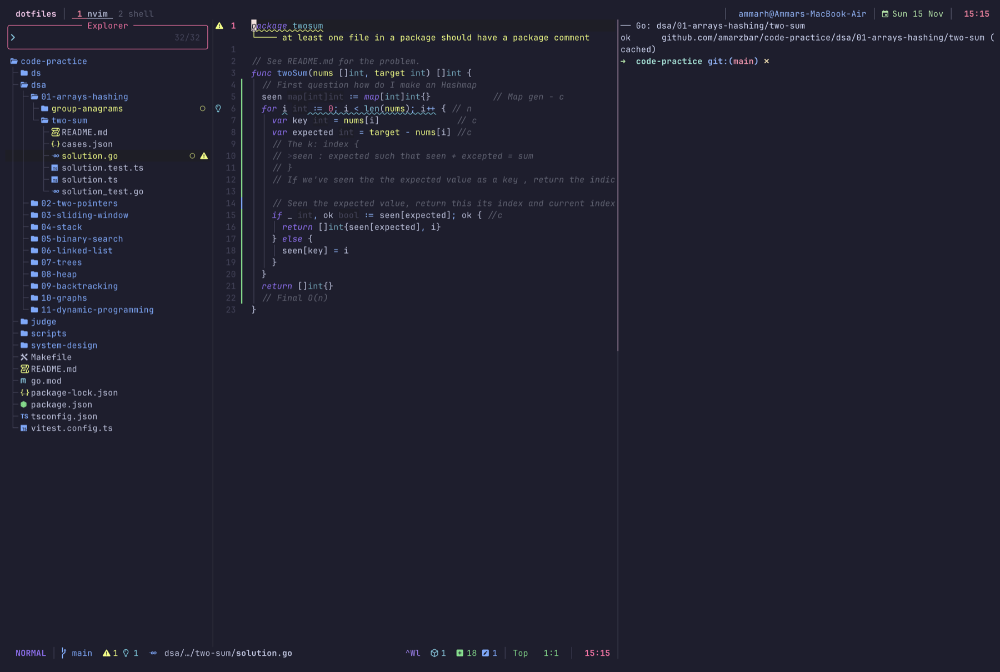
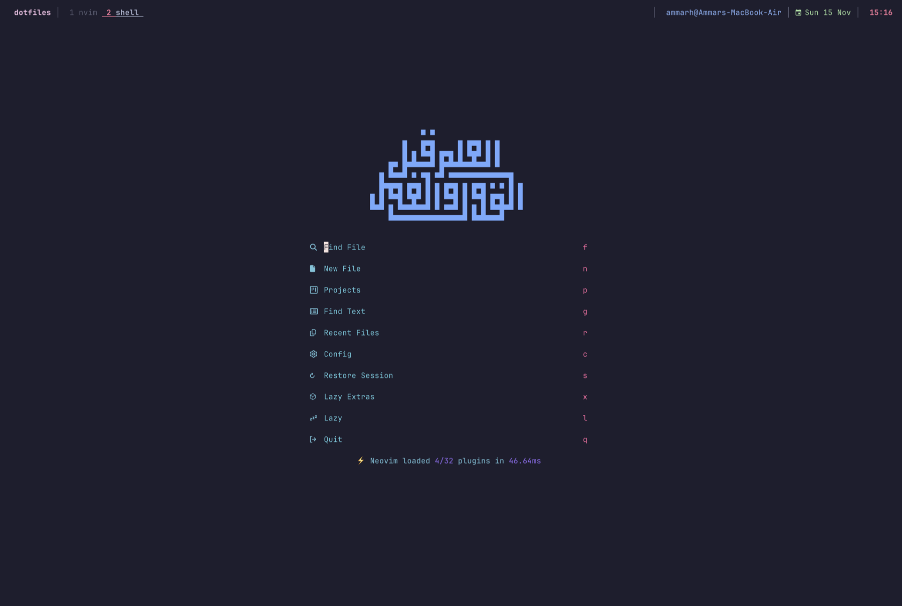
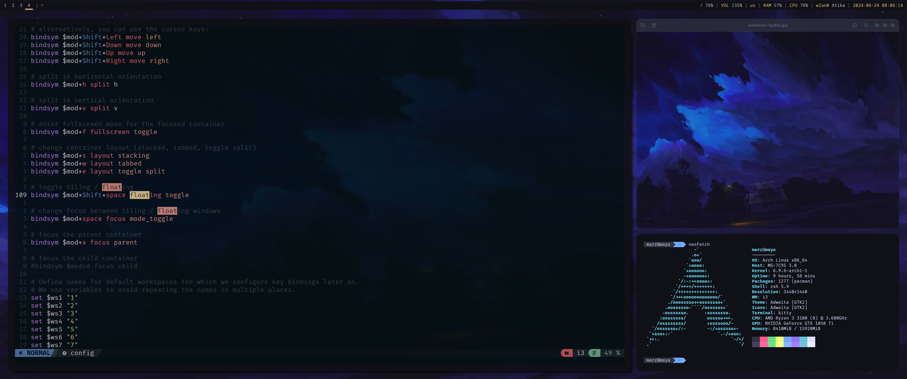

# My Dotfiles

My terminal setup on macOS: **Neovim** (LazyVim) inside **tmux**, both themed from the same terminal palette. The older Arch Linux desktop configs (i3, Polybar, Rofi, picom, kitty) live here too.





## Install

```bash
git clone https://github.com/amarzbar/dotfiles.git ~/dotfiles
cd ~/dotfiles
./install.sh            # symlinks each folder into ~/.config
```

On macOS:

```bash
brew install neovim tmux ripgrep fd go node
```

Use a [Nerd Font](https://www.nerdfonts.com/) in your terminal so the icons render. On the first start, Neovim installs its plugins, and Mason installs the language servers.

## Neovim

`nvim/` is a [LazyVim](https://www.lazyvim.org/) config.

- **Languages:** the Go and TypeScript extras plus ESLint (`lazyvim.json`). This gives `gopls` (with staticcheck), golangci-lint, `vtsls` and the ESLint language server, all installed by Mason.
- **Theme** (`lua/plugins/colorscheme.lua`): tokyonight with a transparent background, recoloured from the terminal's palette. It reads `~/.config/kitty/current-theme.conf` at startup and falls back to Cherry Midnight.
- **Statusline:** lualine styled like the tmux bar, with transparent background, coloured text and muted `│` dividers. The mode name changes colour by mode.
- **Diagnostics** (`lua/plugins/lsp.lua`): the full message shows under the cursor's line, wrapped to the window width, instead of being cut off at the end of the line.
- **Dashboard:** a square Kufic header.
- **Notes autosave** (`lua/config/autocmds.lua`): an unnamed buffer is saved as `<cwd>/YYYY-MM-DD.md` the first time you leave insert mode, then autosaves.
- **Terminal keys:** `<C-v>` goes from terminal mode to visual mode, and `<C-x>` goes to normal mode.

## tmux

`tmux/tmux.conf`

| Key | Action |
|---|---|
| `C-Space` | prefix |
| `prefix \|` / `prefix -` | split side by side / top and bottom (keeps the current directory) |
| `prefix h j k l` | move between panes |
| `prefix H J K L` | resize the pane |
| `prefix v` | copy mode: `v` selects, `V` selects a line, `C-v` selects a block, `y` copies to the clipboard |
| `prefix r` | reload the config |

The status bar sits at the top. It uses only ANSI colour indices, so it follows whatever theme the terminal uses, and the background stays transparent. Mouse support is on, windows are numbered from 1, and Esc is fast for Neovim.

## Arch Linux (i3)



| Config | Path |
|---|---|
| i3 | `i3/config` |
| Polybar | `polybar/` |
| Rofi | `rofi/` |
| picom | `picom/picom.conf` |
| kitty | `kitty/kitty.conf` |

```bash
sudo pacman -S i3 rofi polybar picom kitty feh neovim tmux
i3-msg restart
```

### Wallpaper

At i3 startup, `feh` sets the wallpaper (see `i3/config`):

```
exec --no-startup-id feh --randomize --bg-fill $HOME/Pictures/Wallpapers/
```

`feh` picks a random image from `~/Pictures/Wallpapers/` and paints it as the X root background. To add images to the rotation, put them in that folder.
